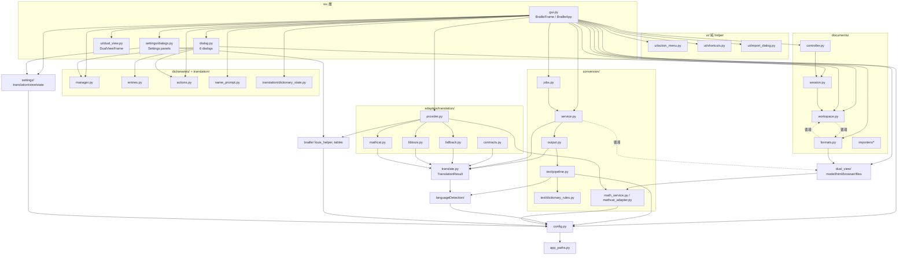

# DotExpress Client 重構審查報告（SOLID / Design Patterns）

- **審查日期**：2026-10-08
- **Reviewer**：Claude Fable 5.1
- **審查範圍**：`client/` 下所有第一方 Python（約 11k 行，不含 tests）。排除 vendored 程式碼 `client/braille/liblouis/__init__.py`（上游 liblouis ctypes binding）與 `client/braille/tables/__tables.py`（NVDA 衍生），僅評論第一方程式碼如何耦合到它們。略過 `.venv`、`__pycache__`、`locales`、`data`。`client/tests/` 僅用來判斷可測性與哪些重構有安全網。
- **審查方式**：唯讀。所有行號皆經實際讀檔核對（`cat -n` / Read），並以 `grep` 驗證符號的跨檔使用情況；另在本機執行一次完整測試套件取得基線（見 §6.0）。
- **本報告唯一的寫入**：本檔案。未修改任何程式碼、未 commit。

---

## 1. 摘要

### 1.1 整體評估

DotExpress client 的整體架構方向是**正確且已走在重構路上**：

- 轉換核心（`conversion/output.py`、`conversion/jobs.py`、`adapters/translation/*`）已採用 Protocol + 依賴注入 + fallback（Null Object），`TranslationRuntime` 是乾淨的 Facade；背景執行緒的 `ConversionJobRunner` 可注入 `thread_factory`/`call_after`，有單元測試覆蓋。
- 文件狀態已部分抽出到 `documents/controller.py` + `documents/session.py`（純函式決策），格式以 `documents/formats.py` 的 descriptor registry 管理。
- 設定對話框採 Template Method（`SettingsPanel`）與不可變快照（`DotExpressSettingsSnapshot`），設計合理。
- `dual_view/*`、`client_init.py`、`app_paths.py`、`dual_view/browser.py` 都是小而純、可注入、可測的模組。

主要問題集中在三處，且彼此相關：

1. **`gui.py::BrailleFrame` 仍是 god class**（第 270–1771 行，約 1,500 行、約 95 個方法），同時承擔視窗佈局、選單建構、鍵盤路由、文件 CRUD + 檔案 IO、匯入/匯出批次流程、字典管理工作流、轉換狀態機、設定套用、Dual View 視窗管理。`DocumentController` 只被「半採用」：Frame 一邊透過 property 轉發到 controller，一邊又直接 `self.documents.append(...)` 繞過它。
2. **全域可變狀態與隱性相依**：`gui.py:230` 的模組級 `language_map_translate_table` 被四處讀寫；`config.py` 以 10+ 個 getter/setter 每次全檔讀寫，且 `_save_to_file` 吞掉所有例外並在首次儲存時偷偷注入 `language_detection` 區段（這點目前已讓 `tests/test_translation_settings.py` 失敗）；`config.get_lang()` 被 `languageDetection`、`conversion/text/pipeline.py`、`conversion/mathcat_adapter.py`、`braille/tables/__init__.py` 直接呼叫，使純邏輯模組隱性依賴磁碟上的設定檔。
3. **重複與邊界模糊**：gettext 初始化 + `resource_path()` 複製了 5 份；`__enter__/__exit__` 樣板在 `dialog.py` 複製 7 次；「選單 key ↔ 標籤」對應表散落 4 處；`choose_selection_after_delete`、`convert_text_with_alignment` 各有兩個同名定義；`conversion ↔ dual_view`、`documents/formats ↔ documents/workspace` 之間存在循環 import，只能靠函式內 import 迴避。

整體而言，這是一個**「中間狀態」的 codebase**：舊的程序式/巨型 Frame 與新的分層設計並存。重構的最佳策略不是重寫，而是**把已經存在的好模式（controller、registry、snapshot、runtime facade）推到底**，把 Frame 裡剩下的流程抽成幾個小型 presenter/service，並且先修補全域狀態的洩漏。

### 1.2 前 5 大建議（依投資報酬排序）

| # | 建議 | 主要檔案 | 工作量 |
|---|------|---------|-------|
| 1 | 將 `language_map_translate_table` 全域可變 dict 收進 `BrailleFrame` 的 `self.view_settings`/`translation_settings` 同層的實例狀態（或一個 `AppSettingsState` 物件），並讓 `ConversionRequest` 攜帶 `lang`，消除 `config.get_lang()` 在純邏輯層的隱性相依 | `gui.py`, `conversion/text/pipeline.py`, `conversion/mathcat_adapter.py`, `languageDetection/__init__.py` | M |
| 2 | 把 `config.py` 改為單一 `ConfigStore`（Repository）：一次讀、一次寫、typed sections，移除「首次儲存注入 `language_detection`」的副作用與 `except Exception: pass`，並補齊/修正 `tests/test_translation_settings.py` | `config.py`, `settings/*.py` | M |
| 3 | 從 `BrailleFrame` 抽出 `DictionaryManagementPresenter`（add/delete/rename/import/export 五個回呼 + 重複三次的 `on_duplicate` lambda），讓 `DictionaryManagementDialog` 接收一個物件而非 5 個位置參數 | `gui.py:1287-1491`, `dialog.py:670-865` | M |
| 4 | 統一「格式 writer」契約與選單描述：移除 `gui._write_export_document` 對 `"html"` 的特判、`gui._get_export_wildcard` 的硬編碼字典，改由 `DocumentFormatDescriptor` 提供；讓 `ui/action_menu.DocumentMenuItem.action` 真正被 `gui` 用來綁 handler（目前以英文 label 字串當 key） | `gui.py`, `documents/formats.py`, `ui/action_menu.py` | S–M |
| 5 | 抽出共用基礎設施：`i18n.py`（單一 gettext 設定 + `resource_path`）、`ui/dialog_base.py`（`ContextManagedDialog` mixin、`SingletonDialogMixin`、`NameDialogBase`），並把 `tests/` 中三份 300 行的 wx stub 合併成 `tests/wx_stub.py` | `gui.py`, `dialog.py`, `settings/dialogs.py`, `dictionaries/entries.py`, `about.py`, `tests/*` | S |

---

## 2. 架構概觀

### 2.1 目前的模組相依圖（簡化）



### 2.2 幾個值得注意的結構事實

| 事實 | 證據 | 意義 |
|------|------|------|
| `gui.py` 沒有任何其他第一方模組 import 它 | `grep -rn "import gui\|from gui"` 僅 tests | Frame 是最頂層，拆分它不會影響其他模組 |
| `config` 被 11 個模組直接 import | `grep -rn "import config\|from config"`：`client_init`, `gui`, `main`, `languageDetection/__init__`, `conversion/math_service`, `conversion/text/pipeline`, `braille/tables/__init__`, `conversion/service`, `settings/translation`, `settings/view`, `settings/translation_tables`, `conversion/mathcat_adapter` | `config.get_lang()` 成為橫跨所有層的隱性全域 |
| `translate.TranslationResult` 被 11 個非測試模組 import | 見 §5 grep | 它事實上是核心值物件，但放在頂層 `translate.py` 且自己又 import `languageDetection.unicode_blocks`，造成多處只能用函式內 import |
| 存在兩組循環：`conversion/service.py:18` ↔ `dual_view/model.py:4`（經 `conversion/math_service`）、`documents/formats.py` ↔ `documents/workspace.py` | `formats.py:38,44,50,56,62,68,74,80` 皆為函式內 import | 循環以延遲 import 掩蓋，是邊界放錯的訊號 |
| gettext 初始化 + `resource_path()` 複製 5 份 | `gui.py:158-174`, `dialog.py:31-47`, `settings/dialogs.py:31-47`, `dictionaries/entries.py:11-23`, `about.py:5-13`（`__tables.py:15,26` 為 vendored） | 改語系/改打包路徑需同步 5 處 |
| 縮排風格混用 | `gui.py` 1,526 行 tab 但第 42–66 行用空白；`dialog.py`/`translate.py`/`conversion/jobs.py`/`dictionaries/*`/`dual_view/*` 用 tab；`settings/dialogs.py`/`config.py`/`documents/workspace.py` 用 4 空白 | AGENTS.md 要求 4 空白；重構 PR 應避免混入全檔 reformat（會淹沒 diff） |

---

## 3. SOLID 逐項分析

### 3.1 SRP（單一職責）

#### S-1：`BrailleFrame` 是 god class（P0）

- **位置**：`client/gui.py:270-1771`
- **問題**：單一 class 內同時包含
  - 佈局/控制項建立：`_create_main_layout` 344–353、`_create_document_list` 355–368、`_create_editor_area` 370–380、`_apply_editor_view_settings` 586–606
  - 選單建構與綁定：`_create_menu_bar` 415–442、`_append_document_menu_items` 451–467、`_bind_document_menu_handlers` 469–484、`_sync_document_menu_state` 486–498、`on_document_context_menu` 1023–1043
  - 鍵盤/焦點路由：`on_char_hook` 1264–1285、`_get_section_controls` 562–567、`_focus_section` 579–581
  - 文件 CRUD + 磁碟 IO：`_create_document` 919–938、`on_rename_document` 1062–1093（直接 `save_document_package` + `old_path.unlink()`）、`on_delete_document` 1095–1125、`on_delete_all_documents` 1127–1162（含失敗回滾）、`_persist_documents` 979–989
  - 匯入/匯出批次流程：`on_import_document` 1164–1197、`_export_document_with_dialog` 812–847、`_export_next_document` 1550–1593（遞迴 `wx.CallAfter` 鏈）、`_write_export_document` 1493–1504
  - 字典管理工作流（5 個回呼）：1309–1491
  - 轉換狀態機：`_start_conversion` 1652–1683、`_show_converting_dialog` 1685–1694、`_complete_conversion` 1704–1753、`_set_conversion_busy` 1642–1650
  - 設定快照/套用：`get_settings_snapshot` 618–624、`apply_settings_from_dialog` 626–644、`_set_view_font_size` 849–855
  - Dual View 視窗生命週期：503–544
- **為何真的會痛**：
  - 任何一條流程改動都要在 1,800 行內找上下文；AGENTS.md 已明示「small focused modules rather than growing gui.py」。
  - 建構順序脆弱：`_sync_document_menu_state` 486–490 需要 `hasattr(self, "documents")`、`"document_list" in self.__dict__` 等防禦；`_get_document_controller` 283–288 用 `self.__dict__.get` 是因為 `_initialize_state` 332–334 先 `self._document_controller = DocumentController()` 再 `self.documents = []`（property setter），而 `_create_menu_bar`（由 `_initialize_frame` 322–324 呼叫）**早於** `_initialize_state` 執行。這些 `hasattr` 檢查是 init 順序耦合的症狀。
  - 測試成本：`tests/test_gui_document_flows.py` 需要 ~290 行的手工 wx stub（第 12–290 行）才能 import `gui`。
- **建議重構**（保留行為、增量）：
  1. **`DocumentWorkspaceService`**（純 Python，無 wx）：把 `_create_document`、`_persist_documents`、`on_rename_document` 的檔案操作、`on_delete_document`/`on_delete_all_documents` 的 unlink + 回滾、`_save_open_document` 內的 `save_document_package` 收攏，輸入為 `DocumentController` + `workspace_dir`，輸出為結果/例外。Frame 只負責 confirm 對話框與錯誤顯示。
  2. **`ExportCoordinator`**：接管 `_export_document_with_dialog`/`_export_next_document`/`_write_export_document`/`_show_export_all_result`，依賴注入「開始轉換」回呼與 `call_after`（與 `ConversionJobRunner` 相同手法），可直接用 `tests/test_conversion_jobs.py` 的 `FakeThread` 風格測。
  3. **`DictionaryManagementPresenter`**：見 S-3。
  4. **`ConversionPresenter`**：`_start_conversion`/`_complete_conversion`/busy 狀態/「converting」對話框計時器。
  5. **`MainMenuBuilder`**：見 O-1。
- **既有安全網**：`tests/test_gui_document_flows.py`（1,179 行）覆蓋大部分文件流程；`tests/test_document_controller.py`、`tests/test_document_session.py`、`tests/test_export_results.py`。抽出純服務後，應先為新服務寫測試，再縮減 GUI stub 測試。

#### S-2：`translate.TranslationResult` 同時是值物件、tokenizer、換行器（P1）

- **位置**：`client/translate.py:10-528`
- **問題**：
  - `__init__` 11–32 每個實例都重建 12 個標點集合並呼叫 `build_language_blocks({"ja","zh","ko"})`（第 32 行）；`__add__` 34–52 每次合併都 new 一個實例 → `conversion/wrapping.merge_translation_results`（`wrapping.py:7-8`）的 `merged = merged + segment` 迴圈對長文件是 O(n²) 的 list 複製 + 重建常數集合。
  - `bind_word_tokens` 106–307 約 200 行、三個 pass，`wrap` 436–528 約 90 行且含難以閱讀的複合布林（456、462、500–503 行）。這是 **tokenization 策略**、**換行政策**、**對位表維護** 三種職責塞在同一 class。
  - 註解已承認脆弱：`wrap` 第 460–461 行「不能與上面條件相同……雖然會爆版，但仍能顯示」。
- **影響**：修改中文/日文斷詞規則或換行政策時必須同時理解對位表更新；效能問題隨文件長度放大。
- **建議**：
  - 常數集合提升為 class attribute（零風險、立即可做）。
  - 抽出 `conversion/tokenize.py::bind_word_tokens(raw, raw_to_braille, braille_to_raw, lang_blocks) -> TokenSpans`（純函式回傳 spans），`TranslationResult.bind_word_tokens()` 變成薄包裝；同理抽 `conversion/line_wrap.py::wrap(tokens, width)`。
  - `merge_translation_results` 改為一次性 `extend`（線性）。
  - 保留 `TranslationResult` 作為**對位資料**值物件，並考慮搬到 `conversion/alignment.py`（見 D-3）。
- **安全網**：`tests/test_translation_result.py`（219 行）、`tests/test_translation_result_core.py`、`tests/test_translation_language_result.py` 已覆蓋 bind/wrap 行為，可先跑再動。

#### S-3：字典管理工作流散在 Frame 與 Dialog 兩邊（P0）

- **位置**：`client/gui.py:1287-1491`、`client/dialog.py:670-865`
- **問題**：
  - `on_open_dictionary_management` 1287–1307 把 5 個 bound method 以位置參數塞給 `DictionaryManagementDialog`（`dialog.py:673-684`）。
  - `add_dictionary` 1309–1338、`rename_dictionary_from_dialog` 1379–1422、`import_dictionary_from_dialog` 1424–1471 三處各自複製相同的 `on_duplicate` lambda（1320–1325、1396–1401、1445–1450）與相同的 `prompt_name` lambda。
  - **兩份字典清單真相來源**：Frame 的 `self._dictionary_names`（`gui.py:329, 610` 以 `[:] =` 就地更新）與 Dialog 自己的 `self._dictionary_names`（`dialog.py:691, 770`），Dialog 還會自己讀磁碟 `_refresh_from_disk` 858–859。
  - `delete_dictionary_from_dialog` 1340–1377 在 UI handler 內做「先刪檔、再更新清單、再決定 active dictionary」三步驟，中途 `OSError` 時狀態是否一致要靠讀程式碼確認。
- **建議**：建立 `dictionaries/presenter.py::DictionaryManagementPresenter`（無 wx），持有 `dictionary_dir`、`names`、`active_name`，暴露 `add(name)`, `delete(name)`, `rename(old,new)`, `import_(path,name)`, `export(name,dest)`，回傳 `DictionaryStateUpdate`（`translation/dictionary_state.py:8-11` 已有此型別）。Frame 只負責：開檔對話框、名稱 prompt、MessageBox。`DictionaryManagementDialog.__init__` 改為接收 presenter 物件（或一個 `DictionaryManagementActions` dataclass）。
- **安全網**：`tests/test_dictionary_manager.py`、`tests/test_dictionary_actions.py`、`tests/test_translation_dictionary_state.py`、`tests/test_dictionary_name_prompt.py`、`tests/test_dictionary_management_dialog.py`。符合 AGENTS.md「dictionary changes span gui.py + dictionaries/manager.py」的提醒 —— 這正是需要一個中間層的訊號。

#### S-4：`SpeechSymbolsDialog` 把 model 與 view 揉在一起（P1）

- **位置**：`client/dialog.py:423-667`
- **問題**：`self.entries`/`self.filtered_entries` 的維護、`filter_entries` 507–537 的「保留前次選取」邏輯、`_identifier_exists` 645–653、`_entry_matches_filter` 503–505 都是純資料邏輯，卻只能透過 wx 控制項呼叫。`tests/test_speech_symbols_dialog.py` 因此有 537 行，多數在 stub。
- 另：第 429 行預設路徑 `Path("data") / "dictionary.csv"` 是相對 CWD 的魔術預設值，實際呼叫端（`gui.py:1305-1306`）一定會傳 `dictionary_path`，此預設值只會在測試或誤用時生效。
- **建議**：抽 `dictionaries/entry_list_model.py::DictionaryEntryListModel`（entries、filter、add/update/remove、duplicate check、`select_after(...)` 回傳 index），Dialog 只做 `SetItemCount/Select/Focus`。這是典型 **MVP（Supervising Controller）**。

#### S-5：`config.py` 是「每個 key 一對函式 + 全檔 IO」的程序式集合（P0）

- **位置**：`client/config.py:47-232`
- **問題**：
  - `get_output_mode`/`get_conversion_width`/`get_selected_dictionary`/`get_view_*` 各自 `_load_from_file()`；`settings/translation.py:70-73` 的 `save_translation_settings` 連續呼叫 3 個 setter → 3 次完整 read-modify-write；而 view 側卻有批次版 `set_view_settings` 208–219。API 不對稱。
  - `_save_to_file` 57–70：`except Exception: pass`（69–70）吞掉所有寫入錯誤 → 使用者改設定卻靜默未存檔；`_load_from_file` 53–54 同樣吞掉 JSON 損毀。
  - `_save_to_file` 59–65 在「檔案不存在」時注入 `language_detection.charset_maps` 預設值 —— 這是 settings 儲存路徑上的隱性副作用，而且**目前已讓 `tests/test_translation_settings.py:63-78` 失敗**（本機驗證：預期只有 `conversion` 區段，實得多出 `language_detection`）。AGENTS.md 明示「Keep config.py behavior and tests aligned」。
  - `set_view_font_size`/`set_view_scheme`/`set_braille_font`（185–206）在 `config.py` 外無任何呼叫者（grep 驗證）→ 死 API。
  - `_runtime_lang` 模組全域（44）+ `set_lang` 131–137。
- **建議**：Repository —— `config.py` 收斂成 `ConfigStore(path)` 提供 `load() -> dict` / `save(dict)` 兩個 IO 方法與 `with_section(...)` 純函式；`settings/translation.py`、`settings/view.py`、`settings/translation_tables.py` 已經是 typed 層，只需改呼叫 `store.update(section, {...})` 一次寫入。首次建立檔案時的預設 `charset_maps` 若仍需要，改為在 `get_charset_maps()` 讀取端套用 default（`_get_dict_setting` 99–109 其實已經做了 merge default，所以寫入端的注入是多餘的）。
- **安全網**：`tests/test_config.py`（262 行）、`tests/test_translation_settings.py`、`tests/test_view_settings.py`、`tests/test_translation_tables.py`、`tests/test_settings_state.py`。先修正 `test_save_persists_one_complete_settings_value` 讓它通過（或明確調整期望），再做結構重構。

#### S-6：`documents/workspace.py` 混合五種關注點（P2）

- **位置**：`client/documents/workspace.py`
- **問題**：`Document` 值物件（21–24）、DEP zip 讀寫（51–94）、txt 匯入（97–105）、批次匯入協調（154–181）、批次匯出（184–203）、以及與文件無關的「刪除後選取」演算法 `choose_selection_after_delete` 206–215。
- `prepare_document_for_save` 122–130 有死參數 `auto_convert=None` 並永遠回傳 `(doc, None)`；呼叫端 `gui.py:889` 以 `updated_document, _ =` 解包 —— 是過去自動轉換功能的殘骸。
- **建議**：拆成 `documents/package.py`（DEP IO）、`documents/batch.py`（匯入/匯出批次），`choose_selection_after_delete` 與 `dictionaries/manager.py:111-120` 的同名函式合併為 `shared/selection.py`（注意兩者語意略異：前者回 `None`，後者回 `DEFAULT_DICTIONARY_NAME`，可用 `default=` 參數統一）。

### 3.2 OCP（開放封閉）

#### O-1：新增一個檔案選單項需要改 3–4 處，且以英文 label 字串當 key（P1）

- **位置**：
  - `client/ui/action_menu.py:14-33` `DOCUMENT_MENU_ITEMS`（有 `action` 欄位："open"、"delete"…）
  - `client/ui/action_menu.py:58-68` `get_document_menu_enabled_state` 回傳以 **label** 為 key 的 dict
  - `client/gui.py:469-484` `_bind_document_menu_handlers` 以 `menu_items["Open"]`、`menu_items["Delete All"]` 等**英文 label** 綁 handler
  - `client/gui.py:179-228` `_MENU_TRANSLATION_MARKERS` 為了讓 gettext 擷取得到動態 label 而硬列 50 個 `_()`。
- **問題**：`DocumentMenuItem.action` 對 command 類型完全沒被用到（grep：僅 submenu 的 `item.action` 在 `gui.py:463` 使用）。label 既是顯示文字、翻譯 key，又是程式識別子；一旦改 label（例如 "Delete All" → "Remove All"），`_bind_document_menu_handlers` 與 `get_document_menu_enabled_state` 會靜默失配（`target_items.get(label)` 496 回 `None` 就跳過），不會丟錯。
- **建議**：
  - 以 `action` 為唯一 key：`handlers = {"open": self.on_open_document, ...}`，`get_document_menu_enabled_state` 回傳 `{action: bool}`。
  - 把 `DOCUMENT_MENU_ITEMS` 擴充為包含 `enabled_when: Literal["always","has_selection","has_documents"]`，`get_document_menu_enabled_state` 由 descriptor 推導 → 新增選單項只改一個 tuple（真正 OCP）。
  - `_MENU_TRANSLATION_MARKERS` 可改為在 `action_menu.py` 內用 `N_ = lambda s: s` 標記（gettext 擷取慣例 `--keyword=N_`），移除 `gui.py` 50 行的假翻譯呼叫。需同步 `scripts\generate_pot.bat` 的 keyword 參數與 `client/locales/zh_TW/LC_MESSAGES/dotexpress.po`。
- **安全網**：`tests/test_action_menu.py`（注意它測的是 `get_document_menu_items`/`get_document_export_format_labels` 等**只有測試在用**的 API，見 §5.4）。

#### O-2：匯出格式的 writer 契約不一致，`gui` 需特判 `"html"`（P1）

- **位置**：
  - `client/documents/formats.py:85-93` `_write_html(path, document, *, dual_view_results=())` —— 多一個 kwarg
  - `client/gui.py:1493-1504` `_write_export_document`：`if descriptor.key == "html": descriptor.writer(..., dual_view_results=...)`
  - `client/documents/workspace.py:200-203` `batch_export_documents_to_folder` 直接 `descriptor.writer(destination_path, document)` —— 對 html 會丟出空 dual view（雖然此函式目前只有測試在用）
  - `client/gui.py:776-781` `_get_export_wildcard` 硬編碼 `{"dep": ..., "brl": ..., "html": ...}`，而 `DocumentFormatDescriptor` 已有 `wildcard_label` + `extension`；`gui.py:766-768` `_get_import_wildcard` 其實已經用 descriptor 泛化產生 wildcard，但**從未被呼叫**（grep 驗證）。
- **建議**：
  - 統一 writer 簽名 `writer(path, document, context: ExportContext)`，`ExportContext` 攜帶 `dual_view_results`（或讓 `Document` 自帶可選的 `dual_view_segments`，因為 `DocumentController.dual_view_results_by_document` 本來就與文件同生命週期）。
  - `_get_export_wildcard` 刪除，改用通用 `format_wildcard(descriptor)`，並把 `CSV_WILDCARD...HTML_WILDCARD`（`gui.py:141-155`）與無人使用的 `IMPORT_WILDCARDS` 149–155 清掉（`IMPORT_WILDCARDS` grep 僅定義處）。
- **安全網**：`tests/test_document_formats.py`、`tests/test_export_results.py`、`tests/test_gui_document_flows.py` 中的匯出案例。

#### O-3：Settings 面板的選項表與領域常數各自為政（P2）

- **位置**：
  - `client/settings/dialogs.py:396-409` `_OUTPUT_MODES`/`_VIEW_SCHEME_OPTIONS`/`_BRAILLE_FONT_OPTIONS`
  - `client/settings/translation.py:20` `SUPPORTED_OUTPUT_MODES`；`client/settings/view.py:15-16` `VIEW_SCHEME_KEYS`/`BRAILLE_FONT_KEYS`；`client/gui.py:131-140` `VIEW_SCHEMES`
  - `client/settings/dialogs.py:614-620` `_options_for_key("math")` 硬寫 `UEB`/`Nemeth`，而 `config.py:31` 已有 `MATH_BRAILLE_TABLES`
  - `client/settings/dialogs.py:514-520` `CHOICE_SPECS` 硬寫 en/zh/ja 語言；`conversion/text/pipeline.py:75` 則以 `translation_tables` 的 key 動態推導語言 → 新增語言需同步兩處。
- **建議**：在 `settings/options.py` 定義 `OutputMode`/`ViewScheme`/`BrailleFont` 的 `(key, label)` 清單一份（label 用 `N_` 標記），`normalize_*` 與面板皆由此取 keys；數學表取 `config.MATH_BRAILLE_TABLES`。

### 3.3 LSP（里氏替換）

整體 LSP 問題不嚴重，因為專案少用繼承、多用 Protocol。幾個小點：

#### L-1：`TranslationResult.__eq__` 對非同型別直接存取屬性（P2）

- **位置**：`client/translate.py:54-60`
- **問題**：`other.raw` 在 `other` 非 `TranslationResult` 時丟 `AttributeError` 而非回傳 `NotImplemented`；且定義 `__eq__` 未定義 `__hash__`（Python 自動設為 None，可接受但應明確）。
- **建議**：`if not isinstance(other, TranslationResult): return NotImplemented`。

#### L-2：`SettingsDialog` 子類 `on_apply` 回傳型別不一致（P2）

- **位置**：`client/settings/dialogs.py:123-124`（基底 `on_apply -> None`）、`164`（`TextProcessingDialog.on_apply -> bool`）、`795`（`DotExpressSettingsDialog.on_apply -> bool`）
- **問題**：子類把 `on_apply` 回傳值當成功旗標（`on_ok` 182、805 依賴它），基底卻宣告 `None`。是契約文件化問題多過實際 bug。
- **建議**：基底改為 `def on_apply(self, event=None) -> bool: return True` 並寫 docstring。

#### L-3：`DocumentFormatDescriptor.loader/writer` 型別為 `object`，實際契約靠呼叫端記憶（P2）

- **位置**：`client/documents/formats.py:26-27`
- 與 O-2 同根。建議以 `Protocol` 或 `Callable[[Path, Document, ExportContext], Path]` 明確化。

### 3.4 ISP（介面隔離）

#### I-1：`DictionaryManagementDialog` 要求 5 個位置回呼（P0，與 S-3 同解）

- **位置**：`client/dialog.py:673-684`、`client/gui.py:1289-1299`
- **問題**：建構子有 9 個參數；呼叫端必須記住順序；任何新增動作（例如 "Duplicate"）都要改簽名與所有呼叫端/測試。
- **建議**：接收一個 `DictionaryManagementActions`（dataclass of callables）或 presenter 物件。

#### I-2：`SettingsPanel` 透過 `owner` 隱性協定取資料（P2）

- **位置**：`client/settings/dialogs.py:66-68`（`self.owner = owner`）、`419-420`、`526`、`639`（`self.owner.snapshot`、`self.owner.dictionary_names`）
- **問題**：面板依賴整個 Dialog 物件，但只需要 `snapshot` 與 `dictionary_names`。測試時必須造一個假的 owner。
- **建議**：`make_settings(self, snapshot, dictionary_names)` 直接傳入，或定義 `class SettingsPanelHost(Protocol)`。低風險。

#### I-3：`ConversionCompletionPolicy` 把 UI 回呼與旗標一起送進 worker thread（P2）

- **位置**：`client/conversion/jobs.py:14-19`
- **問題**：`on_success`/`on_error`（UI 回呼）、`update_output`/`show_success`（UI 旗標）跟著 request 進入背景執行緒再原樣回傳。它們沒在 worker 內被用到，只是「寄放」。這不是錯，但命名為 `Policy` 會讓人以為 runner 會依它做決策。
- **建議**：若保留此設計，更名為 `ConversionCompletionContext`（或泛型 `user_data`）；或由 `ConversionPresenter`（S-1 第 4 點）以 `job_id → policy` 的 dict 自行保存，runner 只回傳 `job_id` 與結果。這能把 `jobs.py` 進一步與 UI 解耦。

### 3.5 DIP（依賴反轉）

#### D-1：`config.get_lang()` 是橫跨所有層的隱性全域（P0）

- **位置**：
  - `client/conversion/text/pipeline.py:4, 79`（純轉換邏輯讀設定檔）
  - `client/languageDetection/__init__.py:6, 183, 365, 382, 399`
  - `client/conversion/mathcat_adapter.py:9, 72`（每次轉換讀一次）
  - `client/braille/tables/__init__.py:25, 117`（NVDA 衍生模組反向依賴 app config）
  - `client/client_init.py:14`（合理，它就是要上報 locale）
- **問題**：`ConversionRequest`（`conversion/output.py:12-18`）已刻意攜帶 `translation_tables`、`dictionary_path`、`data_dir`，顯示作者意圖是「request 自足」；但 `pipeline.translate_plain_text_segment` 第 79 行又偷讀 `config.get_lang()`，使同一個 request 在不同環境變數（`TEXT2BRAILLE_LANG`）下結果不同，且測試必須 patch 全域（`tests/test_language_detection_*` 多處 patch `config.get_lang`）。
- **建議**：`ConversionRequest` 新增 `lang: str`；`LanguageDetector.__init__` 接收 `default_lang` 與 `charset_maps`（不再 import config）；`MathCATAdapter.get_braille_for_mathml` 接收 `language` 參數。`braille/tables/__init__.py` 的 `getDefaultTableForCurLang` 在 app 內無呼叫者（grep 驗證僅定義處），可改為接收 `lang` 參數以切斷 vendored → config 的反向依賴。
- **安全網**：`tests/test_conversion_text_pipeline.py`、`tests/test_language_detection_*.py`、`tests/test_mathcat_adapter.py`、`tests/test_conversion_service.py`。

#### D-2：`language_map_translate_table` 模組級可變 dict（P0）

- **位置**：`client/gui.py:230`（建立）、`622`（讀）、`637-638`（`clear()`+`update()` 就地改）、`790`（`copy()` 進 request）、`1529` 與 `1609`（兩處相同的「default table 未選」檢查）
- **問題**：這是 Frame 的狀態卻放在模組全域；`DotExpressSettingsSnapshot` 已有 `translation_tables` 欄位（`settings/state.py:10`），所以 Frame 其實已持有同資料的不可變版本，只是沒拿來用。兩個真相來源。
- **建議**：改為 `self.translation_tables: dict[str,str]`（或直接保存 `self.settings_snapshot`），`apply_settings_from_dialog` 只替換參考。1529 與 1609 的重複檢查合併為 `_require_default_table() -> str | None`。
- **安全網**：`tests/test_gui_document_flows.py` 有多個案例 patch `gui.language_map_translate_table`（需同步改為設定 frame 屬性）。

#### D-3：`translate.TranslationResult` 位置導致多處只能函式內 import（P1）

- **位置**：`client/conversion/wrapping.py:2`、`client/conversion/preprocessing/literal_braille.py:6`（函式內 `from translate import TranslationResult`）；`client/adapters/translation/contracts.py:6`（頂層 import）；`client/translate.py:3-7` import `languageDetection.unicode_blocks`
- **問題**：`translate.py` 是頂層模組卻被 `adapters`、`conversion` 依賴；它又依賴 `languageDetection`，而 `conversion/text/pipeline.py:72-73` 也對 `languageDetection`、`text.zhuyin` 做函式內 import。`tests/test_translation_import_isolation.py` 的存在證明 import 邊界是刻意維護但脆弱的。
- **建議**：把 `TranslationResult`（純對位資料 + 合併）搬到 `conversion/alignment.py`，tokenizer/wrapper 依 S-2 拆出並明確依賴 `languageDetection.unicode_blocks`；`translate.py` 留下 re-export 以免破壞既有 import。

#### D-4：`conversion ↔ dual_view` 循環（P1）

- **位置**：`client/conversion/service.py:18`（import `dual_view.model.DualViewSegment`）、`client/dual_view/model.py:4`（import `conversion.math_service.latex_to_mathml`）
- **問題**：`DualViewSegment` 是轉換的**輸出**，定義在呈現層 `dual_view` 內，使轉換層依賴呈現層；`dual_view/model.py` 又需要 `latex_to_mathml` 來做 source_html。目前因 import 順序剛好不爆，但任何在 `dual_view/__init__.py` 新增 re-export 都可能觸發 ImportError。
- **建議**：`DualViewSegment` 搬到 `conversion/output.py`（與 `ConversionOutput` 同處）；`dual_view/model.build_dual_view_model` 已有 `mathml_converter` 注入點（第 44 行），把預設改為 `None` + 呼叫端（`gui.py:513`、`documents/formats.py:92`）傳入，即可移除 `dual_view → conversion` 依賴。

#### D-5：`documents/formats ↔ documents/workspace` 循環（P2）

- **位置**：`client/documents/formats.py:38,44,50,56,62,68,74,80`（8 個函式內 import）、`client/documents/workspace.py:10`
- **建議**：`Document` 值物件移到 `documents/model.py`；loader/writer 實作放在 `documents/package.py`、`documents/importers`；`formats.py` 只 import 這些葉子模組。

#### D-6：`braille/` 第一方膠水在 import 時呼叫 `logging.basicConfig`（P2）

- **位置**：`client/braille/louis_helper.py:22-26`、`client/braille/tables/__init__.py:28-32`
- **問題**：`basicConfig` 會在 root logger 掛上 StreamHandler，與 `log.py:7-28` 的「每個 logger 自己的 FileHandler + `propagate=False`」策略衝突；只要有人 import `braille.tables`（`settings/dialogs.py:12` 就會），整個 process 的 root logging 設定即被改寫。
- **建議**：在第一方膠水中移除 `basicConfig`，改 `log = logging.getLogger(__name__)`；需要時由 `log.get_logger("dotexpress.liblouis", "liblouis.log")` 統一。`louis_helper._resolveTableInner` 第 65 行存取 `braille_tables._tablesDirs` 私有成員，可在 `tables/__init__.py` 開一個 `get_table_directory(source)` 公開函式。
- **注意**：`louis_helper.py` 與 `tables/__init__.py` 標頭為 NVDA 版權，是「NVDA 衍生但第一方維護」的膠水；依使用者範圍可評論，但改動時應保持與 `scripts\sync-nvda.py` 同步策略一致（確認它們不在 sync 覆蓋範圍，否則改動會被覆蓋）。

#### D-7：`app_paths` 以 service-locator 風格被各模組呼叫（P2）

- **位置**：`client/app_paths.py:50-67` 五個 `get_*_directory(path=None)`；呼叫端如 `dictionaries/manager.py:16,20,31`、`documents/workspace.py:38,48`、`dual_view/files.py:23,31`、`log.py:17`；`config.py:10` 在 import 時就固定 `CONFIG_PATH`
- **問題**：`ApplicationPaths`（11–22）是現成的注入物件，`BrailleApp.OnInit` 1788 也拿到了它，但隨即丟掉，其後各模組各自用 `None` 預設值再算一次。測試因此需要在 import 前 patch。
- **建議**：`BrailleFrame.__init__` 接收 `paths: ApplicationPaths`（如同已接收 `runtime`），再往下傳；`config.CONFIG_PATH` 改為 `ConfigStore(paths.config)` 的參數（配合 S-5）。

---

## 4. Design Patterns 分析

### 4.1 已存在且運用良好的模式（建議保留、擴大採用）

| 模式 | 位置 | 評價 |
|------|------|------|
| **Strategy / Protocol + Null Object** | `adapters/translation/contracts.py:13-25`（`BrailleTextTranslator`、`MathSegmentTranslator` Protocol）、`adapters/translation/fallback.py:18-32`（fallback 實作）、`adapters/translation/provider.py:30-60`（失敗時換 fallback 並記 log） | 很好。平台無關、可測、錯誤處理集中。`tests/test_translation_fallback.py`、`tests/test_translation_runtime_provider.py` 覆蓋。 |
| **Facade** | `adapters/translation/contracts.py:28-39` `TranslationRuntime`（text + math + close callbacks） | 好。`gui.py:271` 以建構子注入，`main.py:16` demo 也用同一入口。 |
| **Template Method** | `settings/dialogs.py:62-99` `SettingsPanel`（`make_settings`/`load_snapshot`/`on_save`/`is_valid`/`validation_error`）、`231-387` `MultiCategorySettingsDialog` 懶建面板 | 好。新增一個設定分類只需新增一個 Panel 子類並加到 `category_classes`（`738-745`），符合 OCP。 |
| **Immutable Snapshot（Memento 變體）** | `settings/state.py:7-35` `DotExpressSettingsSnapshot` + `with_*`/`copied()`；`settings/dialogs.py:772-802` `_collect` → `commit` → 重新 `load_snapshot` | 好。Apply/Cancel 語意清楚。 |
| **Registry** | `documents/formats.py:96-176` `DOCUMENT_FORMATS` + `get_format` | 方向正確，但 writer 契約不一致（O-2）削弱了它。 |
| **Command-ish 背景工作 + 回呼封送** | `conversion/jobs.py:46-119` `ConversionJobRunner`（`job_id` 防過期回呼、`call_after` 注入） | 好。`tests/test_conversion_jobs.py` 以 `FakeThread` 驗證。 |
| **Pipeline with injected stages** | `conversion/output.py:40-85` `convert_text_with_alignment(request, *, translate_segments, wrap_translation_results, map_char, runtime)` + `ConversionStageError(stage)` | 好。階段錯誤分類讓 `gui._finish_conversion_failure` 1758–1771 能對應不同訊息。 |
| **Pure decision functions** | `documents/session.py`（`plan_open_document`、`plan_delete_document`）、`translation/dictionary_state.py`（`plan_dictionary_state_after_*`）、`dictionaries/actions.py` | 好。這是「先算決策、再由 UI 執行」的正確分層，應成為 Frame 拆分的範本。 |
| **Adapter（ctypes/第三方隔離）** | `adapters/translation/liblouis.py`、`adapters/translation/mathcat.py`、`dual_view/browser.py:83-105`（`finder`/`popen`/`startfile` 注入）、`ui/font_support.py:19-33` | 好。 |
| **Callback-driven virtual list** | `dialog.py:404-420` `CallbackVirtualListCtrl` | 小而好。`DictionaryEntryListCtrl = CallbackVirtualListCtrl`（420）為相容別名，可在確認無外部引用後移除。 |

### 4.2 被誤用或半途而廢的模式

#### P-1：Controller 半採用（`DocumentController`）

- `gui.py:283-320` 以 6 組 property 把 `documents`/`_open_document_name`/`_selected_document_name`/`_dual_view_results_by_document` 轉發給 controller，看似封裝，但：
  - `gui.py:933` `self.documents.append(document)`、`1188` `self.documents.extend(saved_documents)` 直接改 list，繞過 controller；
  - `gui.py:1088, 1116, 1148, 1157` 又直接呼叫 `self._document_controller.*`；
  - `gui.py:539-544` `_rename_dual_view_result`/`_delete_dual_view_result` 已被 controller 內建邏輯取代（`controller.py:82-83, 89`）但仍留著且無人呼叫（grep 驗證）。
- **建議**：刪除 property 轉發層與死方法，Frame 一律透過 `self.controller.add_document(doc)`/`add_documents(docs)` 等明確方法操作；`DocumentController` 補 `add_document`、`add_documents`。這會讓 `_sync_document_menu_state` 的 `hasattr` 防禦變得不必要。

#### P-2：Singleton 以 classmethod 實作兩次

- `settings/dialogs.py:127-228` `TextProcessingDialog` 與 `738-872` `DotExpressSettingsDialog` 各自實作 `_instance`、`_destroy`（188–191 / 813–816）、`_is_destroyed_window_error`（194–205 / 825–836，逐字相同）、`show_singleton`（208–228 / 839–872）。
- **建議**：`ui/dialog_base.py::SingletonDialogMixin`（`_instance` 以 `cls.__dict__` 區分子類、`_destroy`、`_raise_existing`），兩個 dialog 只保留各自的建構參數轉送。`tests/test_settings_dialogs.py` 已覆蓋 singleton 行為。

#### P-3：Observer 缺席，改以「反向 classmethod 探針」替代

- `gui.py:855` `DotExpressSettingsDialog.sync_open_font_size(self.view_settings.font_size)` → `settings/dialogs.py:875-896` 以 classmethod 找到實例、`isinstance(panel, ViewSettingsPanel)` 翻找面板、檢查 `font_size_dirty`。
- **問題**：Frame 必須知道 settings dialog 的內部結構（有個 View 面板、有 dirty 旗標）。
- **建議**：最小改動 —— Frame 持有 `self._settings_dialog: DotExpressSettingsDialog | None`（已有相同手法處理 `_dual_view_frame` 338、503–508），呼叫實例方法 `dialog.on_external_view_change(view_settings)`；或引入極簡 event bus（`ui/events.py::Signal`），Frame `publish(ViewSettingsChanged)`，dialog 在 `__init__` 訂閱、`_destroy` 取消訂閱。後者對未來「字體大小變更也要同步 Dual View」更友善。

#### P-4：Registry 之外的 if/else 分派

- `gui.py:1497`（`if descriptor.key == "html"`）、`gui.py:776-781`（export wildcard dict）、`settings/dialogs.py:614-620`（`if key == "math"`）。見 O-2、O-3。

### 4.3 建議新增的模式與具體擺放位置

| 模式 | 擺放 | 取代什麼 | 不建議過度設計的界線 |
|------|------|---------|------------------|
| **Presenter（MVP，Supervising Controller）** | `dictionaries/presenter.py`、`dictionaries/entry_list_model.py`、`documents/export_coordinator.py`、`documents/workspace_service.py`、`conversion/presenter.py` | `BrailleFrame` 內的流程方法；`SpeechSymbolsDialog` 內的 list 邏輯 | 不需要抽象 `View` 介面 + 完整 MVP 框架；Presenter 直接接收 `Callable` 回呼（如 `confirm: Callable[[str,str],bool]`、`show_error: Callable[[str],None]`）即可，與 `prompt_dictionary_name_until_success`（`dictionaries/name_prompt.py:14-30`）既有風格一致。 |
| **Repository** | `config.py::ConfigStore`；`conversion/text/dictionary_rules.py` 的 `DictionaryRules.load(dictionary_path, bopomofo_path)` | 每呼叫重讀 CSV（`dictionary_rules.apply_dictionary` 143–216 每個語言片段讀兩個 CSV；`char_maps._load_char_mapping` 5–30 每次轉換讀兩次） | 不需要 ORM 式抽象；一個 `@dataclass(frozen=True) LoadedDictionary` + `from_paths()` classmethod 就夠，於 `convert_text_with_alignment` 開頭載入一次並傳入。 |
| **Builder** | `ui/menu_builder.py::build_document_menu(menu, descriptors, handlers_by_action, enabled_by_action)` | `gui._append_document_menu_items` + `_bind_document_menu_handlers` + `_sync_document_menu_state`，供 menubar 與 context menu 共用（`gui.py:444-449` 與 `1037-1040` 現在已是同一組呼叫，只是住在 Frame 內） | 不需要 fluent API。 |
| **Mixin / Template** | `ui/dialog_base.py::ContextManagedDialog`（`__enter__/__exit__`）、`NameDialogBase`（`_on_ok`/`_validate_name` 的共同骨架，子類只給 `normalizer` 與訊息） | `dialog.py` 7 份 `__enter__/__exit__`；`DictionaryNameDialog` 244–270 與 `DocumentNameDialog` 309–333 幾乎相同的兩對方法 | — |
| **Typed error（取代 stringly-typed 判斷）** | `shared/name_validation.py::NameValidationError(code: Literal["empty","invalid","too_long","reserved"])` | `dialog.py:81-105` `_normalize_dialog_name` 先重做一半驗證、再以 `"exceed" in str(exc)`（103）猜錯誤類型；`entries.py:49-60` 在 domain 層產生翻譯後訊息 | 不需要例外階層樹；一個 code 欄位即可，由 dialog 對應到 `_()` 訊息。 |
| **Event bus（極簡）** | `ui/events.py` | P-3 的反向探針 | 若只有一個訂閱者，直接持有實例參考即可；bus 僅在第二個訂閱者出現時再引入。 |

---

## 5. 其他 code smells（與重構相關者）

### 5.1 重複（Duplication）

| 項目 | 位置 | 備註 |
|------|------|------|
| gettext 初始化 + `resource_path` | `gui.py:158-174`、`dialog.py:31-47`、`settings/dialogs.py:31-47`（`parents[1]`）、`dictionaries/entries.py:11-23`、`about.py:5-13` | 建議 `i18n.py` 單一來源：`resource_path()`, `_`, `N_`。注意 `settings/dialogs.py` 的 `resource_path` 用 `parents[1]`，其他用 `parent`，是不同目錄深度的手工修正 —— 集中後自然消失。 |
| `__enter__/__exit__` 樣板 | `dialog.py:204-208, 272-276, 335-339, 375-379, 397-401, 436-440, 861-865` | 7 份。 |
| `on_duplicate` / `prompt_name` lambda | `gui.py:1314-1325, 1386-1401, 1439-1450` | 3 份。 |
| 「default table 未選」檢查 | `gui.py:1529-1536, 1609-1617` | 2 份，訊息相同。 |
| `_is_destroyed_window_error` | `settings/dialogs.py:194-205, 825-836` | 逐字相同。 |
| `choose_selection_after_delete` | `documents/workspace.py:206-215`、`dictionaries/manager.py:111-120` | 同演算法、不同 fallback。 |
| `find_document`/`replace_document`/`document_names` | `documents/session.py:19-37` vs `documents/controller.py:29-47, 71-72` | controller 已包裝 session，但 `get_document` 又自己寫一次迴圈（41–47）。 |
| `convert_text_with_alignment` 同名兩定義 | `conversion/output.py:40`、`conversion/service.py:110` | service 版是 output 版的 dual-view 擷取包裝；建議 service 版更名 `convert_with_dual_view` 或 output 版更名 `run_conversion_pipeline`。 |
| `resolve_selected_dictionary` → `resolve_dictionary_selection` → `resolve_management_selection` | `dictionaries/manager.py:105`、`dictionaries/actions.py:33`、`translation/dictionary_state.py:14` | 三個名字、一個函式，皆為 pass-through。保留一個。 |
| 語言 block 表 | `languageDetection/__init__.py:83-150`、`languageDetection/unicode_blocks.py:21-60` | ja/zh/ko/CJK 清單在兩處維護。 |
| `build_import_wildcard`/`get_import_filter_labels`/`ALL_SUPPORTED_FILTER_INDEX` | `documents/formats.py:183-210`、`ui/import_dialog.py:32-45` | `ui/import_dialog.py` 多半是純轉發；`get_default_import_filter_index`、`get_import_wildcard_text` 無任何呼叫者。 |
| wx stub 測試骨架 | `tests/test_gui_document_flows.py:12-290`、`tests/test_settings_dialogs.py:10-~200`、`tests/test_speech_symbols_dialog.py` | 三份近似 300 行的手工 stub。抽成 `tests/wx_stub.py::install()`。 |

### 5.2 全域狀態 / 單例

- `gui.py:230` `language_map_translate_table`（D-2）。
- `config.py:44` `_runtime_lang` + `config.CONFIG_PATH`（import 時定值，`config.py:10`）。
- `conversion/mathcat_adapter.py:97-104` `_SHARED_ADAPTER` 模組單例 + `global`；由 `math_service.mathml_to_nemeth_braille`（40–43）函式內 import 後呼叫；`adapters/translation/mathcat.py::MathCATMathTranslator` 只接收 `translate_math` callable，因此 `TranslationRuntime.close()` **不會**釋放 MathCAT 的 DLL 目錄 handle（`_dll_directory_handle` 24、54）。建議 provider 直接把 `MathCATAdapter` 實例注入 `MathCATMathTranslator`，並提供 `close()`。
- `documents/workspace.py:108-112` `IMPORT_LOADERS` 模組級 dict，`tests/test_document_workspace.py:186-192, 225-231` 以 mutate + restore 當測試縫；改為 `batch_import_documents(..., loaders=None)` 參數注入即可去除全域。
- `braille/tables/__init__.py:58-101, 228-229` ChainMap 全域（NVDA 衍生，接受）。

### 5.3 錯誤處理

- `config.py:53-54, 69-70` `except Exception: pass/return {}` —— 靜默吞錯（S-5）。
- `conversion/text/pipeline.py:130` `assert translations, "..."` 用 assert 做控制流程（`python -O` 會移除）；應 `raise ValueError`。
- `conversion/text/dictionary_rules.py:191-194` `try: target = processing(target) except Exception: pass` —— Bopomofo 正規化失敗時靜默沿用原值；至少應記 log。
- `dialog.py:185-187, 198-199` 以 `RuntimeError` 捕捉「wx 物件已銷毀」—— 與 `settings/dialogs.py` 的 `_is_destroyed_window_error` 是同一問題的兩種解法；統一到 mixin。
- `gui.py:1793-1796` `except OSError as cause: error = ApplicationDataError(paths.dual_view, cause)`：若 `prepare_application_directories` 本身丟出非 `ApplicationDataError` 的 `OSError`，`paths` 會是未綁定名稱而引發 `NameError`。目前因 `app_paths.prepare_application_directories` 70–89 已把所有 `OSError` 包成 `ApplicationDataError` 所以不會發生，但這是靠巧合而非結構保證；把 `cleanup_dual_view_html` 移到獨立 try 區塊即可。
- `gui.py:1642-1648` `_set_conversion_busy` 以 `menu_bar.FindMenu(_("File"))` **翻譯後的標籤**尋找選單 —— 若 .po 中 "File" 的翻譯與選單建立時不同（例如熱切換語系）會找不到而靜默略過。建議建立選單時保存 index/`wx.Menu` 參考。

### 5.4 死碼 / 僅測試使用的 API（重構前先清理可降低拆分面積）

經 `grep` 驗證在 `client/`（排除 tests）無呼叫者：

- `gui.py`：`IMPORT_WILDCARDS` 149–155、`_create_labeled_group` 555–560、`_get_import_wildcard` 766–768、`_rename_dual_view_result` 539–541、`_delete_dual_view_result` 543–544。
- `config.py`：`set_view_font_size` 185、`set_view_scheme` 195、`set_braille_font` 205。
- `conversion/text/dictionary_rules.py`：`translate__mapping_string` 111–140。
- `conversion/text/char_maps.py`：`preprocess_bopomofo_characters` 64–70、`map_braille_to_ascii` 73–79；`translate__mapping_char` 49–61 僅是 `map_characters` 的別名（被 `output.py:7`、`service.py:3` 用作預設值）。
- `conversion/text/pipeline.py`：`apply_plain_text_rules` 49–61（僅 tests）。
- `languageDetection/__init__.py`：`process_for_spelling` 396–442（無呼叫者）；`add_detected_language_commands` 內 `if False and (...)` 死分支 262–284（23 行）。
- `dictionaries/import_flow.py` 整個模組（僅 `tests/test_dictionary_import_flow.py` 使用；app 走 `name_prompt.prompt_dictionary_name_until_success`）。
- `ui/action_menu.py`：`build_actions_button_label`、`get_actions_menu_position`、`get_document_menu_items`、`get_dictionary_action_labels`、`get_document_action_labels`、`get_document_export_format_labels/keys`（僅 `tests/test_action_menu.py`）；其中 `DOCUMENT_MENU_ITEMS[-2]`（80、84）以負索引取 Export 子選單，順序一改即錯。
- `ui/import_dialog.py`：`get_default_import_filter_index`、`get_import_wildcard_text`。
- `documents/workspace.py`：`batch_export_documents_to_folder` 184–203、`list_document_names` 133–138（僅 tests）；`prepare_document_for_save` 的 `auto_convert` 參數。
- `documents/formats.py`：`get_exportable_formats` 186–187（僅 tests）。
- `braille/tables/__init__.py`：`getDefaultTableForCurLang` 105–124（app 無呼叫者，卻是該模組依賴 `config` 的唯一理由）。

**處理原則**：刪除前先確認對應測試是否仍有價值；「只為死 API 存在的測試」一併移除或改測真正的呼叫路徑（例如 `test_action_menu.py` 應改測 `get_document_menu_descriptors` + `get_document_menu_enabled_state`，因為那才是 `gui` 真正用的）。

### 5.5 命名與可讀性

- `conversion/service.py:21-23` 以 `_translate_plain_text_segment = translate_plain_text_segment` 之類的模組別名作為測試 monkeypatch 縫 —— 隱性契約；建議改為函式參數注入（`output.py` 已示範）。
- `conversion/jobs.py::ConversionCompletionPolicy` 命名（I-3）。
- `translate.py` 檔名與 `translation/` 套件、`adapters/translation/`、`settings/translation.py` 四者名稱極近，造成導航困難（D-3 的搬移可一併解決）。
- `languageDetection/`（camelCase 套件名、NVDA 遺風）與其他 `snake_case` 套件不一致；`LanguageDetector` 內部變數 `curLang`/`tmpLang`/`sb` 亦為 NVDA 風格。若不重寫，至少在模組 docstring 標明「NVDA/WorldVoice 衍生，風格刻意保留」。
- `dialog.py` 的 `SpeechSymbolsDialog` 名稱來自 NVDA 的 speech symbol dialog，但它編輯的是**點字字典**；class docstring（424）已說明，但類名會誤導。改名 `DictionaryEntriesDialog` 需同步 `gui.py:117, 1306` 與 4 個測試檔。

### 5.6 效能相關（由結構引起）

- `dictionary_rules.apply_dictionary` 每呼叫重讀兩個 CSV（159–205），而 `pipeline.translate_plain_text_segment` 84 在**每個語言片段**都呼叫一次 → 一份中英混排文件的轉換會重讀字典 N 次。Repository 一次載入即可（§4.3）。
- `char_maps._load_char_mapping` 每次轉換讀 `BopomofoChar2Braille.csv` 與 `Braille2Ascii.csv`。
- `pipeline.py:76` 每個片段 new 一個 `LanguageDetector`（其 `__init__` 73–177 建表）。
- `TranslationResult.__add__` 的 O(n²) 合併與每實例重建常數（S-2）。
- 以上在短文件感受不到，但 PDF/EPUB 匯入後整本書轉換時會放大；且 `ConversionJobRunner` 雖在背景執行緒，`_set_conversion_busy` 會鎖住 UI 直到完成。

---

## 6. 重構路線圖

### 6.0 基線（2026-10-08 於 Linux 本機執行）

```
cd client && python3 -m unittest discover -s tests -p "test_*.py"
Ran 418 tests ... FAILED (failures=2, errors=10, skipped=7)
```

- **10 個 errors** 全為本機缺第三方套件（`lxml`、`mammoth`、`latex2mathml`）導致的 import 失敗（`test_docx_importer`、`test_epub_importer`、`test_html_to_ast`、`test_import_fixtures`、`test_markdown_ast`、`test_markdown_renderer`、`test_pdf_importer`、`test_math_service` ×3）；安裝 `client/requirements.txt` 後應消失，不是程式碼問題。
- **7 個 skipped** 為 Windows-only（liblouis `WINFUNCTYPE`）。
- **2 個 failures 為既有行為漂移，重構前應先決定處置**：
  1. `tests/test_translation_settings.py:63-78` `test_save_persists_one_complete_settings_value` —— `config._save_to_file` 59–65 在新檔注入 `language_detection` 區段（S-5）。
  2. `tests/test_conversion_service.py:324-336` `test_translate_with_language_does_not_duplicate_existing_spaces_around_math` —— 實得 `['計算 ', '1+2', ' ', '的值']`，預期 `['計算 ', '1+2', ' 的值']`；與 `conversion/service.py:42-49` 邊界空白插入或 `translate.bind_word_tokens` 的空白 token 處理有關。這是行為問題而非結構問題，但它正好落在 S-2 要拆的區域，應先釐清預期行為再動刀。

### 6.1 P0（先做：降低風險、建立安全網，1–2 個 sprint）

| # | 目標 | 涉及檔案 | 風險 | 工作量 | 前置測試 | 驗證指令 |
|---|------|---------|------|-------|---------|---------|
| P0-1 | 修正/對齊 `config.py` 與測試：移除 `_save_to_file` 的 `language_detection` 注入（讀取端已 merge default）、`_save_to_file`/`_load_from_file` 改為 log 而非吞錯；刪除未使用的三個 `set_view_*` | `config.py`, `tests/test_config.py`, `tests/test_translation_settings.py` | 低（行為：設定檔首次建立時少一個區段；`get_charset_maps` 結果不變） | S | 既有 `tests/test_config.py`、`tests/test_translation_settings.py`、`tests/test_view_settings.py`；新增「寫入失敗會記 log」測試 | `cd client && python3 -m unittest tests.test_config tests.test_translation_settings tests.test_view_settings tests.test_translation_tables -v` |
| P0-2 | 消除 `gui.language_map_translate_table` 全域：改為 `BrailleFrame.translation_tables` 實例屬性；合併兩處 default-table 檢查 | `gui.py:230,622,637-638,790,1529,1609`, `tests/test_gui_document_flows.py`（patch 點改為 frame 屬性） | 低 | S | `tests/test_gui_document_flows.py` 全綠 | `cd client && python3 -m unittest tests.test_gui_document_flows -v` |
| P0-3 | 刪除 §5.4 所列死碼與死 API；調整僅為死 API 存在的測試（`test_action_menu.py` 改測 descriptors/enabled_state；`test_dictionary_import_flow.py` 隨模組移除） | `gui.py`, `config.py`, `conversion/text/*.py`, `languageDetection/__init__.py`, `dictionaries/import_flow.py`, `ui/action_menu.py`, `ui/import_dialog.py`, `documents/workspace.py`, 對應 tests | 低 | S | grep 再確認無呼叫者 | `cd client && python3 -m unittest discover -s tests -p "test_*.py"` |
| P0-4 | 建立 `tests/wx_stub.py`，三個 GUI 測試檔改用共用 stub | `tests/test_gui_document_flows.py`, `tests/test_settings_dialogs.py`, `tests/test_speech_symbols_dialog.py`, `tests/test_dictionary_management_dialog.py` | 低（純測試） | S | — | `cd client && python3 -m unittest tests.test_gui_document_flows tests.test_settings_dialogs tests.test_speech_symbols_dialog tests.test_dictionary_management_dialog -v` |
| P0-5 | `i18n.py`：單一 gettext + `resource_path` + `N_`；5 處改 import | `gui.py`, `dialog.py`, `settings/dialogs.py`, `dictionaries/entries.py`, `about.py`, 新 `i18n.py`；`scripts\generate_pot.bat`（加 `--keyword=N_`） | 低（注意 `settings/dialogs.py` 的 `parents[1]` 路徑差異要在 `i18n.resource_path` 以 `client/` 根為準） | S | `tests/test_import_fixtures.py`（需 `lxml`）、`tests/test_dialog_validation.py`（驗證 zh_TW 訊息） | `cd client && python3 -m unittest tests.test_dialog_validation tests.test_dialog_display -v`；Windows 上執行 `scripts\generate_pot.bat` 確認 .pot 內容不變 |
| P0-6 | `DictionaryManagementPresenter`：抽出 5 個回呼 + 共用 `on_duplicate`/`prompt_name`；Dialog 改收 actions 物件；單一字典清單真相來源 | `gui.py:1287-1491`, `dialog.py:670-865`, 新 `dictionaries/presenter.py`, `tests/test_dictionary_management_dialog.py`, 新 `tests/test_dictionary_presenter.py` | 中（dictionary 流程是 AGENTS.md 點名的高耦合區） | M | 先為 presenter 寫測試（add/delete/rename/import/export 成功與 `OSError`/`FileExistsError`/`ValueError` 路徑；active dictionary 切換），再搬 | `cd client && python3 -m unittest tests.test_dictionary_presenter tests.test_dictionary_management_dialog tests.test_dictionary_manager tests.test_dictionary_actions tests.test_translation_dictionary_state tests.test_dictionary_name_prompt tests.test_gui_document_flows -v` |

### 6.2 P1（核心分層：2–4 個 sprint）

| # | 目標 | 涉及檔案 | 風險 | 工作量 | 前置測試 | 驗證指令 |
|---|------|---------|------|-------|---------|---------|
| P1-1 | `ConversionRequest.lang`；`LanguageDetector(default_lang, charset_maps, ...)`；`MathCATAdapter.get_braille_for_mathml(..., language)`；移除 `pipeline`/`languageDetection`/`mathcat_adapter`/`braille/tables` 對 `config` 的 import | `conversion/output.py`, `conversion/text/pipeline.py`, `languageDetection/__init__.py`, `conversion/mathcat_adapter.py`, `conversion/math_service.py`, `adapters/translation/mathcat.py`, `braille/tables/__init__.py`, `gui.py:783-791`, `main.py` | 中（語言偵測結果對 `lang` 敏感；需確認 `TEXT2BRAILLE_LANG` 行為由 `BrailleFrame` 讀一次後傳入） | M | 既有 `tests/test_language_detection_*.py`、`tests/test_conversion_text_pipeline.py`、`tests/test_mathcat_adapter.py`；新增「相同 request 在不同 env 下結果相同」測試 | `cd client && python3 -m unittest tests.test_conversion_text_pipeline tests.test_language_detection_char_langinfo tests.test_language_detection_translation tests.test_language_detection_unicode_braille tests.test_mathcat_adapter tests.test_conversion_service tests.test_translation_import_isolation -v` |
| P1-2 | 統一 export writer 契約（`ExportContext`）、移除 `gui` 的 `"html"` 特判與硬編碼 wildcard；`DocumentMenuItem` 以 `action` 綁 handler、enabled 規則進 descriptor；`ui/menu_builder.py` | `documents/formats.py`, `documents/workspace.py:184-203`, `gui.py:444-498, 766-781, 1023-1043, 1493-1504`, `ui/action_menu.py`, 新 `ui/menu_builder.py` | 中（選單是使用者可見行為，需截圖；AGENTS.md：Actions menu 需同時檢查 popup binding 與 ordering helpers） | M | `tests/test_document_formats.py`、`tests/test_action_menu.py`（改寫）、`tests/test_gui_document_flows.py` 匯出案例；新增 `tests/test_menu_builder.py` | `cd client && python3 -m unittest tests.test_document_formats tests.test_action_menu tests.test_menu_builder tests.test_gui_document_flows -v` |
| P1-3 | `DocumentController` 推到底：補 `add_document(s)`，移除 `gui` property 轉發與直接 list 操作；抽 `documents/workspace_service.py`（檔案 IO + 回滾） | `gui.py:283-320, 919-998, 1062-1197`, `documents/controller.py`, 新 `documents/workspace_service.py` | 中 | M | 先為 `workspace_service` 寫測試（rename 時舊檔刪除、delete-all 失敗回滾） | `cd client && python3 -m unittest tests.test_document_controller tests.test_document_session tests.test_document_workspace tests.test_workspace_service tests.test_gui_document_flows -v` |
| P1-4 | `ExportCoordinator` + `ConversionPresenter` 抽出；`ConversionCompletionPolicy` 更名或改由 presenter 保存 | `gui.py:812-847, 1519-1603, 1605-1771`, `conversion/jobs.py`, 新 `documents/export_coordinator.py`, 新 `conversion/presenter.py` | 中（非同步鏈；用 `FakeThread`/同步 `call_after` 測） | M | 參考 `tests/test_conversion_jobs.py` 寫同步版測試 | `cd client && python3 -m unittest tests.test_conversion_jobs tests.test_export_coordinator tests.test_conversion_presenter tests.test_gui_document_flows -v` |
| P1-5 | `TranslationResult` 常數提升為 class attr；`merge_translation_results` 線性化；`DualViewSegment` 搬到 `conversion/output.py`；`build_dual_view_model` 的 `mathml_converter` 改必填注入 | `translate.py:11-52`, `conversion/wrapping.py`, `conversion/service.py:18`, `dual_view/model.py:4,44`, `gui.py:513`, `documents/formats.py:92` | 低–中 | S | `tests/test_translation_result*.py`、`tests/test_dual_view_model.py`、`tests/test_conversion_service.py` | `cd client && python3 -m unittest tests.test_translation_result tests.test_translation_result_core tests.test_dual_view_model tests.test_dual_view_html tests.test_conversion_service -v` |
| P1-6 | 字典/字元表 Repository：`LoadedDictionaryRules.from_paths()` 於 `convert_text_with_alignment` 載入一次；`pipeline` 不再每片段重讀 | `conversion/text/dictionary_rules.py`, `conversion/text/char_maps.py`, `conversion/text/pipeline.py`, `conversion/output.py` | 低（純效能/結構，輸出不變） | M | `tests/test_conversion_text_dictionary_rules.py`、`tests/test_conversion_text_char_maps.py`、`tests/test_conversion_text_pipeline.py` | `cd client && python3 -m unittest tests.test_conversion_text_dictionary_rules tests.test_conversion_text_char_maps tests.test_conversion_text_pipeline tests.test_conversion_service -v` |

### 6.3 P2（品質提升，可穿插進行）

| # | 目標 | 涉及檔案 | 風險 | 工作量 | 前置測試 | 驗證指令 |
|---|------|---------|------|-------|---------|---------|
| P2-1 | `ui/dialog_base.py`：`ContextManagedDialog`、`SingletonDialogMixin`、`NameDialogBase`；`NameValidationError(code)` 取代字串判斷 | `dialog.py`, `settings/dialogs.py`, `shared/name_validation.py`, `dictionaries/manager.py`, `documents/workspace.py` | 低 | S | `tests/test_dialog_validation.py`、`tests/test_settings_dialogs.py`（singleton 案例） | `cd client && python3 -m unittest tests.test_dialog_validation tests.test_dialog_display tests.test_settings_dialogs -v` |
| P2-2 | `DictionaryEntryListModel` 從 `SpeechSymbolsDialog` 抽出；考慮更名 `DictionaryEntriesDialog` | `dialog.py:423-667`, 新 `dictionaries/entry_list_model.py`, `gui.py:117,1306`, 4 個測試檔 | 低 | M | 先為 model 寫測試（filter 保留選取、新增時清除 filter、重複判斷） | `cd client && python3 -m unittest tests.test_dictionary_entry_list_model tests.test_speech_symbols_dialog -v` |
| P2-3 | 設定選項單一來源（`settings/options.py`），math 表取 `config.MATH_BRAILLE_TABLES` | `settings/dialogs.py:396-409,514-520,614-620`, `settings/translation.py`, `settings/view.py`, `gui.py:131-140` | 低 | S | `tests/test_settings_dialogs.py`、`tests/test_translation_settings.py`、`tests/test_view_settings.py` | 同上 |
| P2-4 | `sync_open_font_size` 改為實例方法/Signal（P-3） | `gui.py:855`, `settings/dialogs.py:875-896` | 低 | S | `tests/test_settings_dialogs.py` 相關案例 | `cd client && python3 -m unittest tests.test_settings_dialogs -v` |
| P2-5 | `translate.py` 拆 tokenizer / line wrapper（S-2）；先釐清並修正 `test_translate_with_language_does_not_duplicate_existing_spaces_around_math` | `translate.py`, 新 `conversion/tokenize.py`, `conversion/line_wrap.py`, `conversion/alignment.py` | 中–高（核心演算法；需以大量真實文本做 golden test） | L | 先新增 golden tests（中/英/日/數學混排、各種標點、寬度邊界） | `cd client && python3 -m unittest tests.test_translation_result tests.test_translation_result_core tests.test_translation_language_result tests.test_conversion_service -v` |
| P2-6 | `ApplicationPaths` 注入到 `BrailleFrame`，`config.ConfigStore(paths.config)`；移除各模組 `get_*_directory(None)` 預設 | `gui.py`, `app_paths.py`, `config.py`, `dictionaries/manager.py`, `documents/workspace.py`, `dual_view/files.py`, `log.py` | 中（測試 fixture 需調整） | M | `tests/test_app_paths.py`、`tests/test_config.py` | `cd client && python3 -m unittest tests.test_app_paths tests.test_config tests.test_gui_document_flows -v` |
| P2-7 | `braille/` 膠水移除 `logging.basicConfig`、公開 `get_table_directory`；`MathCATAdapter` 由 provider 注入並支援 `close()` | `braille/louis_helper.py`, `braille/tables/__init__.py`, `adapters/translation/provider.py`, `adapters/translation/mathcat.py`, `conversion/mathcat_adapter.py` | 低（Windows-only 驗證） | S | `tests/test_liblouis_adapter.py`、`tests/test_liblouis_runtime.py`（Windows）、`tests/test_translation_runtime_provider.py` | Windows：`cd client && python -m unittest tests.test_liblouis_runtime tests.test_translation_runtime_provider -v` |
| P2-8 | 縮排統一為 4 空白（AGENTS.md）—— **獨立 PR、不混入任何邏輯變更** | 使用 tab 的 ~15 個檔案 | 低（純格式，但 diff 巨大） | S | 全套件 | `cd client && python3 -m unittest discover -s tests -p "test_*.py"` 並 `git diff -w --stat` 應為 0 行語意變更 |

### 6.4 執行順序建議

```
P0-1 ─┬─ P0-2 ─┬─ P0-3 ─ P0-4 ─ P0-5
      │        └─ P0-6 ─────────────┐
      └─ P1-1 ──────────────────────┼─ P1-3 ─ P1-4
P1-2 ──────────────────────────────┘
P1-5 ─ P1-6 ─ P2-5
P2-1 … P2-4、P2-6、P2-7 可平行；P2-8 最後單獨做
```

每一步都保持「行為不變、測試先綠」；每個 PR 附上該列的驗證指令與（涉及 wx 對話框/選單時）截圖，並在改動使用者可見字串時同步 `client/locales/zh_TW/LC_MESSAGES/dotexpress.po` 與 `.mo`。

---

## 7. 不建議變更的部分 / 取捨說明

1. **不要重寫 `languageDetection/`**。它是 NVDA/WorldVoice 衍生的成熟演算法，有 3 個測試檔覆蓋；本報告只建議（a）移除 `config` 相依（D-1）、（b）刪 `if False` 死分支與 `process_for_spelling`、（c）把 block 表與 `unicode_blocks.py` 合一。camelCase 命名與 NVDA 風格註解可保留並在 docstring 說明來源。
2. **不要為 `conversion/jobs.py` 引入通用 task framework**。目前的 `ConversionJobRunner` 剛好夠用、可測；I-3 只是命名/職責微調。
3. **不要把 `documents/formats.py` 的 registry 改成 plugin/entry-point 機制**。格式數量固定（7 種），tuple 即可；要修的是契約一致性（O-2），不是擴充機制。
4. **不要為 wx 引入完整 MVP 框架或抽象 View 介面**。專案已有成功先例（`documents/session.py` 的 plan 函式、`name_prompt.py` 的 callable 注入），沿用「純 Python presenter + callable 回呼」即可；抽象 View 會讓 wx stub 測試更複雜而非更簡單。
5. **不要在重構 PR 中順手改縮排**。AGENTS.md 要求 4 空白，但 `gui.py`、`dialog.py`、`translate.py` 等大檔用 tab；格式統一應獨立成 P2-8，否則 reviewer 無法辨識語意差異。
6. **不要動 vendored 檔案**（`braille/liblouis/__init__.py`、`braille/tables/__tables.py`）；對 `louis_helper.py` 與 `tables/__init__.py` 的建議（D-6）動手前先確認 `scripts\sync-nvda.py` 不會覆蓋它們，否則應改以 adapter 層包裝而非修改原檔。
7. **`settings/dialogs.py` 的 Template Method 與 Snapshot 設計請保留**；它是目前最乾淨的 UI 子系統，P2-3/P2-4 只是去重與解耦，不是重做。
8. **`client_init.py`、`app_paths.py`、`dual_view/browser.py`、`dual_view/files.py`、`ui/shortcuts.py`、`ui/section_navigation.py`、`shared/name_validation.py`、`text/zhuyin.py`、`documents/importers/*`** 在本次審查中沒有值得動的結構問題；它們是小、純、可注入、有測試的模組，應作為其他模組的範本而非重構對象。（`documents/importers/pdf_importer.py` 的 `_flatten_blocks` 154–239 偏長且 role 分派用 if-chain，但這是 PDF 結構樹的本質複雜度，且有 `tests/test_pdf_importer.py`；若要改可考慮 role→handler dict，屬 P3 以下。）
9. **取捨：`TranslationResult` 的大重構（P2-5）報酬高但風險也最高**。建議先只做 P1-5 的低風險部分（常數提升、線性合併、搬位置），等 golden tests 建好、並釐清 `test_conversion_service.py:324` 的預期行為後再拆 tokenizer/wrapper。
10. **取捨：event bus**。目前只有一個「設定對話框需同步字體大小」的場景，持有實例參考（如 `_dual_view_frame` 的做法）已足夠；只有當 Dual View 也要響應設定變更時才值得引入 `Signal`。

---

## 附錄 A：關鍵行號速查（已逐一核對）

| 主題 | 位置 |
|------|------|
| `BrailleFrame` 範圍 | `client/gui.py:270-1771` |
| 全域 `language_map_translate_table` | `client/gui.py:230, 622, 637-638, 790, 1529, 1609` |
| gettext 標記 hack | `client/gui.py:179-228` |
| controller property 轉發 / 繞過 | `client/gui.py:283-320` / `933, 1188` / `1088, 1116, 1148, 1157` |
| 選單以 label 綁 handler | `client/gui.py:469-484`；`client/ui/action_menu.py:14-33, 58-68` |
| html writer 特判 / wildcard 硬編碼 | `client/gui.py:1493-1504` / `776-781`；`client/documents/formats.py:85-93` |
| 字典 5 回呼 | `client/gui.py:1287-1491`；`client/dialog.py:673-684` |
| 轉換狀態機 | `client/gui.py:1642-1771` |
| 匯出批次遞迴鏈 | `client/gui.py:1550-1593` |
| `config` 吞錯 / 注入副作用 / 死 setter | `client/config.py:53-54, 69-70` / `59-65` / `185-206` |
| `config.get_lang()` 隱性相依 | `client/conversion/text/pipeline.py:79`；`client/languageDetection/__init__.py:183, 365, 382, 399`；`client/conversion/mathcat_adapter.py:72`；`client/braille/tables/__init__.py:117` |
| `TranslationResult` 常數/合併/長方法 | `client/translate.py:11-32` / `34-52` / `106-307, 436-528` |
| 循環 import | `client/conversion/service.py:18` ↔ `client/dual_view/model.py:4`；`client/documents/formats.py:38-80` ↔ `client/documents/workspace.py:10` |
| 字典 CSV 每次重讀 | `client/conversion/text/dictionary_rules.py:159-205`；`client/conversion/text/char_maps.py:5-30`；呼叫於 `client/conversion/text/pipeline.py:84` |
| `assert` 控制流程 | `client/conversion/text/pipeline.py:130` |
| Singleton 重複 | `client/settings/dialogs.py:188-228` vs `813-872` |
| 反向探針 `sync_open_font_size` | `client/gui.py:855` → `client/settings/dialogs.py:875-896` |
| `logging.basicConfig` 於 import | `client/braille/louis_helper.py:22-26`；`client/braille/tables/__init__.py:28-32` |
| 失敗測試 | `client/tests/test_translation_settings.py:63-78`；`client/tests/test_conversion_service.py:324-336` |
